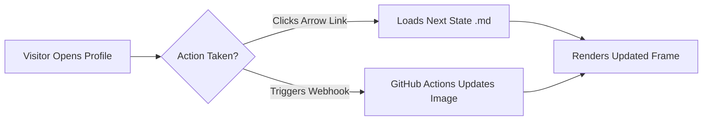

<div align="center">

# GitHub Profile Sandbox & Loophole Showcase

<p>A live reference profile demonstrating every HTML tag, GitHub Flavored Markdown extension, and rendering loophole permitted by <a href="https://github.com/orgs/community/discussions/144854">GitHub's sanitization pipeline</a>.</p>

<kbd>Ctrl</kbd> + <kbd>Shift</kbd> + <kbd>P</kbd> &nbsp;|&nbsp; <mark>Sanitizer-Safe HTML</mark> &nbsp;|&nbsp; <ruby>GFM<rt>GitHub Flavored Markdown</rt></ruby> &nbsp;|&nbsp; H<sub>2</sub>O &amp; E=mc<sup>2</sup>

</div>

---

## 1. Allowed Raw HTML Layout & Text Wrapping

GitHub strips `style`, `class`, and `id` attributes ([Stack Overflow](https://stackoverflow.com/questions/44831505/which-inline-html-styles-does-github-markdown-accept)), but retains legacy HTML alignment attributes (`align="center"`, `align="left"`, `align="right"`) and structural tags ([HTML Tags on GitHub](https://gist.github.com/seanh/13a93686bf4c2cb16e658b3cf96807f2)).

- **Centered & Right-Aligned Containers:** Wrapping Markdown or HTML inside `<div align="center">` or `<p align="right">` aligns blocks without CSS.
- **Multi-Column Layouts & Spanning Cells:** Standard HTML `<table>` tags allow `colspan`, `rowspan`, and nested formatting that pipe tables cannot express ([Stack Overflow](https://stackoverflow.com/questions/14951321/how-to-display-html-content-in-github-readme-md)).

<table>
  <thead>
    <tr>
      <th align="left">HTML Element</th>
      <th align="left">What It Renders</th>
      <th align="left">Live Output</th>
    </tr>
  </thead>
  <tbody>
    <tr>
      <td><code>&lt;kbd&gt;</code></td>
      <td>Physical keyboard button styling</td>
      <td>Press <kbd>Cmd</kbd> + <kbd>K</kbd></td>
    </tr>
    <tr>
      <td><code>&lt;ins&gt;</code> &amp; <code>&lt;del&gt;</code></td>
      <td>Semantic diff insertions and deletions</td>
      <td><del>Old value</del> &rarr; <ins>Updated value</ins></td>
    </tr>
    <tr>
      <td><code>&lt;ruby&gt;</code> &amp; <code>&lt;rt&gt;</code></td>
      <td>Ruby phonetic or micro-annotations above text</td>
      <td><ruby>4,340<rt>Markdown States</rt></ruby></td>
    </tr>
    <tr>
      <td><code>&lt;sub&gt;</code>, <code>&lt;sup&gt;</code>, <code>&lt;mark&gt;</code></td>
      <td>Subscripts, superscripts, and yellow highlight</td>
      <td>x<sub>i</sub><sup>2</sup> = <mark>Active</mark></td>
    </tr>
    <tr>
      <td colspan="3" align="center"><em>Full-width footer cell using <code>colspan="3"</code> and <code>align="center"</code></em></td>
    </tr>
  </tbody>
</table>

---

## 2. Interactive Accordions Without JavaScript (`<details>`)

Because `<script>` tags are stripped ([Stack Overflow](https://stackoverflow.com/questions/14951321/how-to-display-html-content-in-github-readme-md)), native HTML5 `<details>` and `<summary>` tags are the primary way to build expandable drawers and spoilers inside a profile.

<details>
<summary><strong>Click to expand: How the Stateless Markdown Game Engine Works</strong></summary>

<br>

In projects like [DoomMe](https://github.com/Kuberwastaken/DoomMe), clicking a directional control inside a README does not run JavaScript ([How I Made DOOM Run Inside a GitHub Readme](https://kuber.studio/blog/Projects/How-I-Made-DOOM-Run-Inside-a-GitHub-Readme)). Instead, every `(x, y, angle)` coordinate on the map is pre-rendered into its own `.md` file, and clicking an arrow simply navigates to the linked file:

<div align="center">

| Turn Left | Move Forward | Turn Right |
| :---: | :---: | :---: |
| [⬅️ Rotate -90°](https://github.com/Kuberwastaken/DoomMe) | [⬆️ Step +64 Units](https://github.com/Kuberwastaken/DoomMe) | [➡️ Rotate +90°](https://github.com/Kuberwastaken/DoomMe) |

</div>

</details>

---

## 3. Theme-Adaptive Images (`<picture>` Light/Dark Mode Switching)

GitHub preserves the HTML `<picture>` and `<source>` elements so your profile can detect whether the visitor uses Light Mode or Dark Mode via `prefers-color-scheme` ([GitHub Blog](https://github.blog/developer-skills/github/how-to-make-your-images-in-markdown-on-github-adjust-for-dark-mode-and-light-mode/)).

<picture>
  <source media="(prefers-color-scheme: dark)" srcset="./custom-card.svg">
  <source media="(prefers-color-scheme: light)" srcset="./custom-card.svg">
  
</picture>

---

## 4. The External `.svg` + `<foreignObject>` CSS Loophole

GitHub strips `<style>` and inline `<svg>` tags written directly in `README.md` ([Dries Vints](https://driesvints.com/blog/investigating-dark-mode-for-svgs-in-github-readmes)). However, if you save an `.svg` file in your repository and embed it via ``, the browser renders both CSS `@keyframes` animations and arbitrary HTML/CSS placed inside an SVG `<foreignObject>` container ([CSS-Tricks](https://css-tricks.com/custom-styles-in-github-readmes/), [Avi Vashishta](https://www.avivashishta.com/blog/github-profile-readme-animated-svg-cards)).

<div align="center">
  <a href="https://css-tricks.com/custom-styles-in-github-readmes/">
    
  </a>
</div>

---

## 5. Native Diagram, Map, and 3D Engines in Code Blocks

GitHub intercepts specific fenced code block languages and renders them inside sandboxed viewers rather than showing static text ([Creating Diagrams - GitHub Docs](https://docs.github.com/en/get-started/writing-on-github/working-with-advanced-formatting/creating-diagrams), [GitHub Changelog](https://github.blog/changelog/2022-03-17-mermaid-topojson-geojson-and-ascii-stl-diagrams-are-now-supported-in-markdown-and-as-files/)):

### A. Mermaid Flowcharts & Sequence Diagrams (`mermaid`)

GitHub passes `mermaid` code blocks to its Viewscreen rendering pipeline ([Include Diagrams with Mermaid](https://github.blog/developer-skills/github/include-diagrams-markdown-files-mermaid/)):



### B. Interactive Vector Maps (`geojson` & `topojson`)

Any `geojson` or `topojson` block turns into a zoomable map ([Creating Diagrams - GitHub Docs](https://docs.github.com/en/get-started/writing-on-github/working-with-advanced-formatting/creating-diagrams)):

```geojson
{
  "type": "FeatureCollection",
  "features": [
    {
      "type": "Feature",
      "properties": { "name": "Profile Location Pin" },
      "geometry": {
        "type": "Point",
        "coordinates": [34.8878, 32.0840]
      }
    }
  ]
}
```

### C. Interactive 3D Models (`stl`)

An ASCII `stl` block renders an interactive 3D mesh that visitors can rotate in their browser ([GitHub Changelog](https://github.blog/changelog/2022-03-17-mermaid-topojson-geojson-and-ascii-stl-diagrams-are-now-supported-in-markdown-and-as-files/)):

```stl
solid tetrahedron
  facet normal 0 0 -1
    outer loop
      vertex 0 0 0
      vertex 0 1 0
      vertex 1 0 0
    endloop
  endfacet
  facet normal 0 -1 0
    outer loop
      vertex 0 0 0
      vertex 1 0 0
      vertex 0 0 1
    endloop
  endfacet
  facet normal -1 0 0
    outer loop
      vertex 0 0 0
      vertex 0 0 1
      vertex 0 1 0
    endloop
  endfacet
  facet normal 0.577 0.577 0.577
    outer loop
      vertex 1 0 0
      vertex 0 1 0
      vertex 0 0 1
    endloop
  endfacet
endsolid tetrahedron
```

---

## 6. Native GFM Alerts, Diffs, LaTeX Math & Task Lists

- **Callout Alerts:** Blockquotes starting with `[!NOTE]`, `[!TIP]`, `[!IMPORTANT]`, `[!WARNING]`, or `[!CAUTION]` render with themed borders and icons ([Learn GFM Syntax](https://www.freecodecamp.org/news/github-flavored-markdown-syntax-examples/)).

> [!TIP]
> **Dynamic External Image Cache-Busting:** You can point an `` tag to a serverless function or a repository file updated on a cron schedule via GitHub Actions to display live metrics or multiplayer game states ([Awesome GitHub Profile READMEs](https://abhisheknaiidu.github.io/awesome-github-profile-readme/)).

- **Colorized Text via `diff` Blocks:** Since CSS text colors are stripped, prefixing lines with `+`, `-`, or `!` inside a `diff` block colors lines green, red, or orange:

```diff
+ Green line: Allowed by the GitHub HTML sanitizer (details, picture, kbd, ruby)
- Red line: Stripped by the sanitizer (script, iframe, style, input, form)
! Orange note: Bypassed when wrapped inside an external .svg via 
```

- **Native MathJax / LaTeX Expressions:** Wrap inline math in `$...$` or display blocks in `$$...$$`:

$$\text{Total Pre-Rendered Files} = N_{\text{grid}} \times N_{\text{angles}} = 1{,}085 \times 4 = 4{,}340$$
