<div align="center">

<picture>
  <source media="(prefers-color-scheme: dark)" srcset="./assets/marquee-dark.svg" width="680" height="210">
  <source media="(prefers-color-scheme: light)" srcset="./assets/marquee-light.svg" width="680" height="210">
  
</picture>

<br>

<kbd>🕹️ 100% IN-PROFILE ENGINE</kbd> &nbsp;|&nbsp; <mark>ZERO PAGE RELOADS</mark> &nbsp;|&nbsp; <ruby>3 STAGES<rt>CAMPAIGN</rt></ruby> &nbsp;|&nbsp; <ruby>7,600<rt>MAX SCORE</rt></ruby> &nbsp;|&nbsp; <ruby>♥♥♥<rt>VAUS LIVES</rt></ruby>

</div>

---

## 🎛️ Arcade Cabinet Control Deck & Live Telemetry

<table>
  <thead>
    <tr>
      <th align="center">STAGE SECTOR</th>
      <th align="center">HIGH SCORE</th>
      <th align="center">VAUS RESERVES</th>
      <th align="center">WEAPON MATRIX</th>
      <th align="center">PHYSICS ENGINE</th>
    </tr>
  </thead>
  <tbody>
    <tr>
      <td align="center"><ruby><strong>STAGE 01–03</strong><rt>SECTOR</rt></ruby></td>
      <td align="center"><ruby><strong>007,600</strong><rt>HI-SCORE</rt></ruby></td>
      <td align="center"><ruby><strong>♥♥♥</strong><rt>VAUS</rt></ruby></td>
      <td align="center"><del>OFFLINE</del> &rarr; <ins>VAUS READY</ins></td>
      <td align="center">v<sub>out</sub><sup>2</sup> = <mark>4.0s CRT Loop</mark></td>
    </tr>
    <tr>
      <td colspan="5" align="center">
        <em>Click any <kbd>◀ SECTOR 1..5 ▶</kbd> paddle control below to intercept the ball inline — zero external links or page reloads.</em>
      </td>
    </tr>
  </tbody>
</table>

---

## 🕹️ STAGE 01: NEON WALL (`800 PTS`)

> [!NOTE]
> **TACTICAL BRIEFING — STAGE 01 (NEON WALL):** A $5 \times 2$ array of **Cyan High-Voltage Bricks (`100 PTS`)** and **Magenta Neon Bricks (`60 PTS`)** blocks the warp gate. Watch the **amber target reticle** at the bottom of each CRT viewport and click the matching `<kbd>SECTOR</kbd>` paddle control to slice through the grid.

<details open>
<summary><kbd>🚀 ENGAGE STAGE 01</kbd> <strong>NEON WALL — RALLY 1.1 (Ball Descending to SECTOR 2)</strong></summary>

<br>

<table>
  <thead>
    <tr>
      <th align="left">Stage 01 Grid Status</th>
      <th align="center">Score</th>
      <th align="center">Incoming Vector</th>
    </tr>
  </thead>
  <tbody>
    <tr>
      <td><ins>C1</ins> <ins>C2</ins> <ins>C3</ins> <ins>C4</ins> <ins>C5</ins> / <ins>M1</ins> <ins>M2</ins> <ins>M3</ins> <ins>M4</ins> <ins>M5</ins> (<code>10/10 Active</code>)</td>
      <td align="center"><ruby>00,000<rt>SCORE</rt></ruby></td>
      <td align="center"><mark>▼ TARGET: SECTOR 2</mark></td>
    </tr>
  </tbody>
</table>

<details name="s1-r1">
<summary><kbd>◀ SECTOR 2 — OPTIMAL LEFT-EDGE SLICE</kbd> <strong>Angle the Vaus hull to ricochet off the left wall (4x Combo)</strong></summary>

<br>

<div align="center">
  
</div>

```diff
+ COMBO x4: Left-edge slice shattered M1 (+60), C1 (+100), C2 (+100), M2 (+60) -> +320 PTS!
! CAPSULE DROP: [E] ENLARGED VAUS caught! Paddle width expanded from 88px to 112px.
+ RADAR LOCK: Ball descending toward SECTOR 3 for Rally 1.2.
```

> [!TIP]
> **POWER-UP ACQUIRED (`[E] ENLARGED VAUS`):** Your spacecraft hull is now widened for the upper-ceiling sweep. Intercept the descending energy ball at **SECTOR 3**!

<table>
  <thead>
    <tr>
      <th align="left">Stage 01 Grid Status (Post-Rally 1.1)</th>
      <th align="center">Score</th>
      <th align="center">Next Intercept</th>
    </tr>
  </thead>
  <tbody>
    <tr>
      <td><del>C1</del> <del>C2</del> <ins>C3</ins> <ins>C4</ins> <ins>C5</ins> / <del>M1</del> <del>M2</del> <ins>M3</ins> <ins>M4</ins> <ins>M5</ins> (<code>6/10 Active</code>)</td>
      <td align="center"><ruby>00,320<rt>SCORE</rt></ruby></td>
      <td align="center"><mark>▼ TARGET: SECTOR 3</mark></td>
    </tr>
  </tbody>
</table>

<details name="s1-r2">
<summary><kbd>▲ SECTOR 3 — OPTIMAL CEILING RICOCHET SWEEP</kbd> <strong>Drive the ball through the central column into the upper ceiling (4x Combo)</strong></summary>

<br>

<div align="center">
  
</div>

```diff
+ COMBO x4: Ceiling ricochet demolished M3 (+60), C3 (+100), C4 (+100), M4 (+60) -> +320 PTS!
+ RADAR LOCK: Only right-corner column (C5, M5) remains! Ball descending to SECTOR 4.
```

<table>
  <thead>
    <tr>
      <th align="left">Stage 01 Grid Status (Post-Rally 1.2)</th>
      <th align="center">Score</th>
      <th align="center">Final Intercept</th>
    </tr>
  </thead>
  <tbody>
    <tr>
      <td><del>C1</del> <del>C2</del> <del>C3</del> <del>C4</del> <ins>C5</ins> / <del>M1</del> <del>M2</del> <del>M3</del> <del>M4</del> <ins>M5</ins> (<code>2/10 Active</code>)</td>
      <td align="center"><ruby>00,640<rt>SCORE</rt></ruby></td>
      <td align="center"><mark>▼ TARGET: SECTOR 4</mark></td>
    </tr>
  </tbody>
</table>

<details name="s1-r3">
<summary><kbd>▶ SECTOR 4 — OPTIMAL RIGHT-CORNER SNIPE</kbd> <strong>Bank off the right wall to shatter M5 &amp; C5 and clear Stage 01!</strong></summary>

<br>

<div align="center">
  
</div>

```diff
+ STAGE 01 CLEAR: Right-corner bank shattered M5 (+60) & C5 (+100) -> +160 PTS!
+ WARP GATE OPEN: Stage 01 Completed with 00,800 PTS and ♥♥♥ Vaus Lives intact!
```

> [!IMPORTANT]
> **STAGE 01 LIBERATED (`00,800 PTS`):** All `10/10` Neon Bricks shattered! Scroll down or expand **STAGE 02: FORTRESS BUNKER** below to enter the Silver Armor sector.

</details>

<details name="s1-r3">
<summary><kbd>● SECTOR 4 — FLAT CENTER GRAZE</kbd> <strong>Clip M5 flat (+60 PTS) and set up a Sector 5 corner tap-in</strong></summary>

<br>

<div align="center">
  
</div>

```diff
! GRAZE SHOT: M5 shattered (+60 PTS), but C5 survived in the top-right corner.
+ RECOVERY READY: Execute the Sector 5 corner tap-in below to finish Stage 01.
```

<details>
<summary><kbd>▶ SECTOR 5 — CORNER RECOVERY TAP-IN</kbd> <strong>Snipe C5 (+100 PTS) and open the Stage 02 Warp Gate</strong></summary>

<br>

<div align="center">
  
</div>

```diff
+ RECOVERY COMPLETE: C5 shattered (+100 PTS) -> Total Score: 00,800 PTS!
```

</details>
</details>

<details name="s1-r3">
<summary><kbd>◀ SECTOR 1 — OVER-CORRECT LEFT (WHIFF)</kbd> <strong>Slide too far left while the ball crosses Sector 4</strong></summary>

<br>

<div align="center">
  
</div>

> [!CAUTION]
> **SHIELD BREACH (`[-1 VAUS LIFE]`):** The ball slipped past Sector 4! Click **SECTOR 4 — OPTIMAL RIGHT-CORNER SNIPE** above to re-serve and clear Stage 01.

</details>

</details>

<details name="s1-r2">
<summary><kbd>● SECTOR 3 — SHALLOW CENTER BANK</kbd> <strong>Deflect flat off M3 &amp; M4 (+120 PTS) and recover from Sector 3</strong></summary>

<br>

<div align="center">
  
</div>

```diff
! SHALLOW DEFLECTION: Cleared bottom row M3 (+60) & M4 (+60), leaving upper C3 & C4 intact.
+ BANK RECOVERY: Re-strike from SECTOR 3 below to finish the upper ceiling sweep!
```

<details>
<summary><kbd>▲ SECTOR 3 — BANK RECOVERY SWEEP</kbd> <strong>Drive through C3 &amp; C4 (+200 PTS) and advance to Rally 1.3</strong></summary>

<br>

<div align="center">
  
</div>

```diff
+ RECOVERY COMPLETE: C3 & C4 shattered (+200 PTS) -> Score: 00,640 PTS!
+ NEXT STEP: Open "▲ SECTOR 3 — OPTIMAL CEILING RICOCHET SWEEP" above to fire Rally 1.3!
```

</details>
</details>

<details name="s1-r2">
<summary><kbd>▶ SECTOR 5 — MISJUDGED DRIFT (WHIFF)</kbd> <strong>Drift to Sector 5 while the ball drops through Sector 3</strong></summary>

<br>

<div align="center">
  
</div>

> [!CAUTION]
> **SHIELD BREACH (`[-1 VAUS LIFE]`):** Ball lost in Sector 3! Select **▲ SECTOR 3 — OPTIMAL CEILING RICOCHET SWEEP** above to re-serve.

</details>

</details>

<details name="s1-r1">
<summary><kbd>● SECTOR 2 — FLAT CENTER BANK DEFLECTION</kbd> <strong>Catch the ball flat to clear M2 &amp; C2 (+160 PTS)</strong></summary>

<br>

<div align="center">
  
</div>

```diff
! FLAT BANK: Shattered M2 (+60) and C2 (+100) -> +160 PTS, leaving left column M1 & C1 standing.
+ RECOVERY VECTOR: Ball rebounding toward SECTOR 1 — execute the left-wall recovery below!
```

<details>
<summary><kbd>◀ SECTOR 1 — BANK RECOVERY SLICE</kbd> <strong>Sweep M1 &amp; C1 (+160 PTS) and merge into Rally 1.2 (`00,320 PTS`)</strong></summary>

<br>

<div align="center">
  
</div>

```diff
+ BANK RECOVERY COMPLETE: M1 & C1 cleared (+160 PTS) -> Score synced at 00,320 PTS!
+ NEXT STEP: Expand "◀ SECTOR 2 — OPTIMAL LEFT-EDGE SLICE" above to continue to Rally 1.2.
```

</details>
</details>

<details name="s1-r1">
<summary><kbd>▶ SECTOR 5 — WRONG SECTOR WHIFF</kbd> <strong>Boost to Sector 5 while the serve lands in Sector 2</strong></summary>

<br>

<div align="center">
  
</div>

```diff
- SHIELD BREACH: Energy ball bypassed floor defense in Sector 2 (-1 VAUS LIFE).
! AUTO RE-SERVE: Vaus launcher re-primed — select "◀ SECTOR 2 — OPTIMAL LEFT-EDGE SLICE" above!
```

> [!CAUTION]
> **BALL LOST (`♥♥♡ VAUS RESERVES`):** Emergency backup Vaus deployed. Click **◀ SECTOR 2 — OPTIMAL LEFT-EDGE SLICE** above to intercept the serve cleanly.

</details>

</details>

---

## 🛡️ STAGE 02: FORTRESS BUNKER (`1,800 PTS`)

> [!NOTE]
> **TACTICAL BRIEFING — STAGE 02 (FORTRESS BUNKER):** The fortress deploys **8 Silver Armor Bricks (`200 PTS` each)** and **2 Emerald Core Bricks (`100 PTS` each)** guarded by **2 Indestructible Gold Bumpers (`◆ GOLD BUMPER L & R ◆`)**. Thread the narrow central channel in **SECTOR 3** to trap the ball inside the upper pinball pocket!

<details>
<summary><kbd>🛡️ ENGAGE STAGE 02</kbd> <strong>FORTRESS BUNKER — RALLY 2.1 (Ball Descending to SECTOR 3)</strong></summary>

<br>

<table>
  <thead>
    <tr>
      <th align="left">Stage 02 Fortress Grid</th>
      <th align="center">Score</th>
      <th align="center">Incoming Vector</th>
    </tr>
  </thead>
  <tbody>
    <tr>
      <td><ins>S1..S8</ins> Silver (<code>8/8</code>) + <ins>E1..E2</ins> Core (<code>2/2</code>) + <mark>◆ G1, G2 Gold Bumpers</mark></td>
      <td align="center"><ruby>00,800<rt>SCORE</rt></ruby></td>
      <td align="center"><mark>▼ TARGET: SECTOR 3</mark></td>
    </tr>
  </tbody>
</table>

<details name="s2-r1">
<summary><kbd>▲ SECTOR 3 — THREAD THE GOLD BUMPER GAP</kbd> <strong>Fire straight between Gold Bumpers G1 &amp; G2 into the fortress core (4x Combo)</strong></summary>

<br>

<div align="center">
  
</div>

```diff
+ PRECISION THREAD: Ball slipped between Gold Bumpers G1 & G2 with 0mm clearance!
+ COMBO x4: Shattered S7 (+200), E1 (+100), E2 (+100), and upper S3 (+200) -> +600 PTS!
+ RADAR LOCK: Central channel breached! Ball descending toward SECTOR 2.
```

<table>
  <thead>
    <tr>
      <th align="left">Stage 02 Grid Status (Post-Rally 2.1)</th>
      <th align="center">Score</th>
      <th align="center">Next Intercept</th>
    </tr>
  </thead>
  <tbody>
    <tr>
      <td><ins>S1</ins> <ins>S2</ins> <del>S3</del> <ins>S4</ins> <ins>S5</ins> / <ins>S6</ins> <del>E1</del> <del>S7</del> <del>E2</del> <ins>S8</ins> (<code>6/10 Destructible Left</code>)</td>
      <td align="center"><ruby>01,400<rt>SCORE</rt></ruby></td>
      <td align="center"><mark>▼ TARGET: SECTOR 2</mark></td>
    </tr>
  </tbody>
</table>

<details name="s2-r2">
<summary><kbd>◀ SECTOR 2 — UPPER POCKET PINBALL COMBO</kbd> <strong>Slice up the left corridor to trap the ball above the Gold Bumpers (+800 PTS)</strong></summary>

<br>

<div align="center">
  
</div>

```diff
+ PINBALL OVERDRIVE: Demolished Silver Armor S6 (+200), S1 (+200), S2 (+200), S4 (+200) -> +800 PTS!
+ RADAR LOCK: Only right-wing armor (S5, S8) remains! Ball descending to SECTOR 5.
```

<table>
  <thead>
    <tr>
      <th align="left">Stage 02 Grid Status (Post-Rally 2.2)</th>
      <th align="center">Score</th>
      <th align="center">Final Intercept</th>
    </tr>
  </thead>
  <tbody>
    <tr>
      <td><del>S1</del> <del>S2</del> <del>S3</del> <del>S4</del> <ins>S5</ins> / <del>S6</del> <del>E1</del> <del>S7</del> <del>E2</del> <ins>S8</ins> (<code>2/10 Destructible Left</code>)</td>
      <td align="center"><ruby>02,200<rt>SCORE</rt></ruby></td>
      <td align="center"><mark>▼ TARGET: SECTOR 5</mark></td>
    </tr>
  </tbody>
</table>

<details name="s2-r3">
<summary><kbd>▶ SECTOR 5 — ARMOR-BREAKER FINISHER</kbd> <strong>Drive a high-velocity shot through S8 &amp; S5 to clear Stage 02!</strong></summary>

<br>

<div align="center">
  
</div>

```diff
+ ARMOR BREAKER: Shattered S8 (+200) and S5 (+200) before ricocheting off Gold Bumper G2 -> +400 PTS!
+ STAGE 02 CLEAR: Fortress Bunker conquered with 02,600 PTS! DOH Core Boss Chamber unlocked!
```

> [!IMPORTANT]
> **STAGE 02 LIBERATED (`02,600 PTS`):** All destructible Silver Armor bricks eliminated! Expand **STAGE 03: DOH CORE (BOSS)** below for the final showdown.

</details>

<details name="s2-r3">
<summary><kbd>● SECTOR 5 — OUTER WALL BANK</kbd> <strong>Destroy S8 (+200 PTS) and rebound off Gold Bumper G2 to Sector 4</strong></summary>

<br>

<div align="center">
  
</div>

```diff
! METALLIC RICOCHET: S8 destroyed (+200 PTS); Gold Bumper G2 deflected the ball to Sector 4.
```

<details>
<summary><kbd>▶ SECTOR 4 — TOP-RIGHT CORNER TAP-IN</kbd> <strong>Shatter S5 (+200 PTS) to complete Stage 02 (`02,600 PTS`)</strong></summary>

<br>

<div align="center">
  
</div>

```diff
+ STAGE 02 COMPLETE: S5 destroyed (+200 PTS) -> Score: 02,600 PTS!
```

</details>
</details>

<details name="s2-r3">
<summary><kbd>◀ SECTOR 1 — BUMPER TRAP WHIFF</kbd> <strong>Leave Sector 5 unguarded against the Gold Bumper ricochet</strong></summary>

<br>

<div align="center">
  
</div>

> [!CAUTION]
> **BUMPER TRAP (`[-1 VAUS LIFE]`):** Select **▶ SECTOR 5 — ARMOR-BREAKER FINISHER** above to re-serve and finish Stage 02!

</details>

</details>

<details name="s2-r2">
<summary><kbd>● SECTOR 2 — LEFT FLANK BANK</kbd> <strong>Clear S6 &amp; S1 (+400 PTS) before clanging off Gold Bumper G1</strong></summary>

<br>

<div align="center">
  
</div>

```diff
! GOLD BUMPER DEFLECTION: S6 & S1 shattered (+400 PTS), ball bounced back to SECTOR 2.
```

<details>
<summary><kbd>◀ SECTOR 2 — POCKET RE-ENTRY SHOT</kbd> <strong>Finish S2 &amp; S4 (+400 PTS) to sync with Rally 2.3 (`02,200 PTS`)</strong></summary>

<br>

<div align="center">
  
</div>

```diff
+ POCKET CLEARED: S2 & S4 shattered (+400 PTS) -> Open "◀ SECTOR 2 — UPPER POCKET PINBALL COMBO" above for Rally 2.3!
```

</details>
</details>

<details name="s2-r2">
<summary><kbd>◀ SECTOR 1 — EARLY SWING WHIFF</kbd> <strong>Swing early in Sector 1 as the ball drops into Sector 2</strong></summary>

<br>

<div align="center">
  
</div>

> [!CAUTION]
> **SHIELD BREACH (`[-1 VAUS LIFE]`):** Click **◀ SECTOR 2 — UPPER POCKET PINBALL COMBO** above to re-serve.

</details>

</details>

<details name="s2-r1">
<summary><kbd>● SECTOR 3 — OFF-CENTER GOLD BUMPER CLANG</kbd> <strong>Ricochet off Gold Bumper G1 into S6 &amp; E1 (+300 PTS)</strong></summary>

<br>

<div align="center">
  
</div>

```diff
! RICOCHET: Indestructible Gold Bumper G1 deflected the shot into S6 (+200) & E1 (+100).
+ RECOVERY: Re-align in SECTOR 3 below to thread the central gap!
```

<details>
<summary><kbd>▲ SECTOR 3 — GAP THREAD RECOVERY</kbd> <strong>Thread the central channel (+300 PTS) and merge into Rally 2.2 (`01,400 PTS`)</strong></summary>

<br>

<div align="center">
  
</div>

```diff
+ GAP BREACHED: S7, E2 & S3 cleared -> Expand "▲ SECTOR 3 — THREAD THE GOLD BUMPER GAP" above for Rally 2.2!
```

</details>
</details>

<details name="s2-r1">
<summary><kbd>◀ SECTOR 1 — MISJUDGED BUMPER BOUNCE (WHIFF)</kbd> <strong>Camp in Sector 1 while the serve drops through Sector 3</strong></summary>

<br>

<div align="center">
  
</div>

> [!CAUTION]
> **SHIELD BREACH (`[-1 VAUS LIFE]`):** Re-serve by clicking **▲ SECTOR 3 — THREAD THE GOLD BUMPER GAP** above.

</details>

</details>

---

## 👁️ STAGE 03: DOH CORE — FINAL BOSS (`5,000 PTS`)

> [!WARNING]
> **BOSS ALERT — STAGE 03 (DOH DIMENSION CORE):** The sentient **DOH Core (`3 HP`)** hovers in the central chamber guarded by **Left & Right Shield Arrays (`SH-L1..R2`, `250 PTS` each)** and **Laser Barrier Pylons (`PYL-L, PYL-R`, `250 PTS` each)**. Dismantle both shield wings to expose the core and unlock the **3D Vaus Victory Vault**!

<details>
<summary><kbd>👁️ ENGAGE STAGE 03 (BOSS)</kbd> <strong>DOH CORE — RALLY 3.1 (Ball Descending to SECTOR 1)</strong></summary>

<br>

<table>
  <thead>
    <tr>
      <th align="left">DOH Boss Chamber Status</th>
      <th align="center">Boss HP</th>
      <th align="center">Score</th>
      <th align="center">Incoming Vector</th>
    </tr>
  </thead>
  <tbody>
    <tr>
      <td><ins>PYL-L</ins> <ins>SH-L1..2</ins> | <strong>👁️ DOH CORE</strong> | <ins>SH-R1..2</ins> <ins>PYL-R</ins></td>
      <td align="center"><ruby><strong>3 / 3</strong><rt>DOH HP</rt></ruby></td>
      <td align="center"><ruby>02,600<rt>SCORE</rt></ruby></td>
      <td align="center"><mark>▼ TARGET: SECTOR 1</mark></td>
    </tr>
  </tbody>
</table>

<details name="s3-r1">
<summary><kbd>◀ SECTOR 1 — BREACH LEFT SHIELD ARRAY &amp; STRIKE DOH CORE</kbd> <strong>Slice up the left wall to vaporize the left wing and deal -1 HP to DOH (+1,500 PTS)</strong></summary>

<br>

<div align="center">
  
</div>

```diff
+ SHIELD BREACH: Vaporized PYL-L (+250), SH-L2 (+250), and SH-L1 (+250)!
+ DIRECT BOSS HIT: Energy ball slammed into DOH CORE (-1 HP! +750 PTS) -> DOH HP: 2/3!
! WEAPON DROP: [L] LASER VAUS ARMED! Twin plasma cannons online for Rally 3.2 at SECTOR 4!
```

> [!TIP]
> **WEAPON UPGRADE (`[L] LASER VAUS ACTIVE`):** Twin crimson plasma beams are locked and loaded! Intercept the boss counter-ricochet at **SECTOR 4**.

<table>
  <thead>
    <tr>
      <th align="left">DOH Boss Chamber Status (Post-Rally 3.1)</th>
      <th align="center">Boss HP</th>
      <th align="center">Score</th>
      <th align="center">Next Intercept</th>
    </tr>
  </thead>
  <tbody>
    <tr>
      <td><del>PYL-L</del> <del>SH-L1..2</del> | <strong>👁️ DOH CORE</strong> | <ins>SH-R1..2</ins> <ins>PYL-R</ins></td>
      <td align="center"><ruby><strong>2 / 3</strong><rt>DOH HP</rt></ruby></td>
      <td align="center"><ruby>04,100<rt>SCORE</rt></ruby></td>
      <td align="center"><mark>▼ TARGET: SECTOR 4</mark></td>
    </tr>
  </tbody>
</table>

<details name="s3-r2">
<summary><kbd>▶ SECTOR 4 — FIRE LASER VAUS &amp; CRUSH RIGHT SHIELD ARRAY</kbd> <strong>Unleash twin plasma beams + ball ricochet to strip DOH's right wing (-1 HP, +1,500 PTS)</strong></summary>

<br>

<div align="center">
  
</div>

```diff
+ LASER SALVO: Twin plasma beams + ricochet vaporized PYL-R (+250), SH-R2 (+250), SH-R1 (+250)!
+ CRITICAL BOSS HIT: DOH CORE struck for -1 HP (+750 PTS) -> DOH HP: 1/3 (CRITICAL)!
+ FINAL LOCK: All shields down! Ball descending dead-center to SECTOR 3!
```

<table>
  <thead>
    <tr>
      <th align="left">DOH Boss Chamber Status (Post-Rally 3.2)</th>
      <th align="center">Boss HP</th>
      <th align="center">Score</th>
      <th align="center">Final Kill Shot</th>
    </tr>
  </thead>
  <tbody>
    <tr>
      <td><del>PYL-L</del> <del>SH-L1..2</del> | <mark><strong>👁️ DOH CORE (EXPOSED)</strong></mark> | <del>SH-R1..2</del> <del>PYL-R</del></td>
      <td align="center"><ruby><strong>1 / 3</strong><rt>CRITICAL</rt></ruby></td>
      <td align="center"><ruby>05,600<rt>SCORE</rt></ruby></td>
      <td align="center"><mark>▼ TARGET: SECTOR 3</mark></td>
    </tr>
  </tbody>
</table>

<details name="s3-r3">
<summary><kbd>🔥 SECTOR 3 — FINAL CORE OVERLOAD (KILL SHOT)</kbd> <strong>Drive a point-blank Laser + Plasma strike straight into the exposed DOH Core (+2,000 PTS)!</strong></summary>

<br>

<div align="center">
  
</div>

```diff
+ CORE OVERLOAD: Direct center-lane impact shattered DOH CORE (-1 HP -> 0/3 DESTROYED, +2,000 PTS)!
+ CAMPAIGN VICTORY: All 3 Stages Cleared! Final Score: 007,600 PTS (Rank: S+ ACE VAUS PILOT)!
```

<br>

<div align="center">
  
</div>

<br>

> [!IMPORTANT]
> **🏆 3D VICTORY VAULT UNLOCKED:** Inspect and rotate your **3D Vaus Spacecraft Trophy** below (rendered natively in your browser via GitHub's interactive ASCII `stl` 3D engine)!

```stl
solid vaus_spacecraft_trophy
  facet normal 0 0 -1
    outer loop
      vertex -30 -8 0
      vertex 30 -8 0
      vertex 30 8 0
    endloop
  endfacet
  facet normal 0 0 -1
    outer loop
      vertex -30 -8 0
      vertex 30 8 0
      vertex -30 8 0
    endloop
  endfacet
  facet normal 0 -0.7071 0.7071
    outer loop
      vertex -30 -8 0
      vertex 30 -8 0
      vertex 22 -3 8
    endloop
  endfacet
  facet normal 0 -0.7071 0.7071
    outer loop
      vertex -30 -8 0
      vertex 22 -3 8
      vertex -22 -3 8
    endloop
  endfacet
  facet normal 0 0.7071 0.7071
    outer loop
      vertex 30 8 0
      vertex -30 8 0
      vertex -22 3 8
    endloop
  endfacet
  facet normal 0 0.7071 0.7071
    outer loop
      vertex 30 8 0
      vertex -22 3 8
      vertex 22 3 8
    endloop
  endfacet
  facet normal -0.7071 0 0.7071
    outer loop
      vertex -30 8 0
      vertex -30 -8 0
      vertex -22 -3 8
    endloop
  endfacet
  facet normal -0.7071 0 0.7071
    outer loop
      vertex -30 8 0
      vertex -22 -3 8
      vertex -22 3 8
    endloop
  endfacet
  facet normal 0.7071 0 0.7071
    outer loop
      vertex 30 -8 0
      vertex 30 8 0
      vertex 22 3 8
    endloop
  endfacet
  facet normal 0.7071 0 0.7071
    outer loop
      vertex 30 -8 0
      vertex 22 3 8
      vertex 22 -3 8
    endloop
  endfacet
  facet normal 0 -0.5547 0.8321
    outer loop
      vertex -22 -3 8
      vertex 22 -3 8
      vertex 0 0 14
    endloop
  endfacet
  facet normal 0 0.5547 0.8321
    outer loop
      vertex 22 3 8
      vertex -22 3 8
      vertex 0 0 14
    endloop
  endfacet
  facet normal -0.2631 0 0.9648
    outer loop
      vertex -22 3 8
      vertex -22 -3 8
      vertex 0 0 14
    endloop
  endfacet
  facet normal 0.2631 0 0.9648
    outer loop
      vertex 22 -3 8
      vertex 22 3 8
      vertex 0 0 14
    endloop
  endfacet
endsolid vaus_spacecraft_trophy
```

</details>

<details name="s3-r3">
<summary><kbd>● SECTOR 3 — CONTAINMENT RING GRAZE</kbd> <strong>Graze DOH's outer containment ring (+500 PTS) and rebound to Sector 3</strong></summary>

<br>

<div align="center">
  
</div>

```diff
! CONTAINMENT GRAZE: Stripped outer core shielding (+500 PTS) -> Execute the point-blank finisher below!
```

<details>
<summary><kbd>🔥 SECTOR 3 — POINT-BLANK OVERLOAD FINISHER</kbd> <strong>Detonate the DOH Core (+1,500 PTS) and claim Victory (`07,600 PTS`)</strong></summary>

<br>

<div align="center">
  
</div>

```diff
+ DOH CORE OBLITERATED: Final Score 007,600 PTS! Expand "🔥 SECTOR 3 — FINAL CORE OVERLOAD" above for the 3D Trophy!
```

</details>
</details>

<details name="s3-r3">
<summary><kbd>◀ SECTOR 2 — COUNTER-LASER WHIFF</kbd> <strong>Drift into Sector 2 as DOH's counter-laser sweeps the floor</strong></summary>

<br>

<div align="center">
  
</div>

> [!CAUTION]
> **COUNTER-LASER BREACH (`[-1 VAUS LIFE]`):** Select **🔥 SECTOR 3 — FINAL CORE OVERLOAD (KILL SHOT)** above to finish DOH!

</details>

</details>

<details name="s3-r2">
<summary><kbd>● SECTOR 4 — RIGHT BARRIER DEFLECTION</kbd> <strong>Destroy PYL-R &amp; SH-R2 (+500 PTS) and reload Laser Vaus in Sector 4</strong></summary>

<br>

<div align="center">
  
</div>

```diff
! BARRIER DEFLECTION: PYL-R & SH-R2 destroyed (+500 PTS), SH-R1 still guarding DOH's right flank.
```

<details>
<summary><kbd>▶ SECTOR 4 — SECOND LASER SALVO</kbd> <strong>Vaporize SH-R1 &amp; strike DOH Core (+1,000 PTS) to reach Rally 3.3</strong></summary>

<br>

<div align="center">
  
</div>

```diff
+ RIGHT WING CLEARED: DOH Core down to 1/3 HP! Expand "▶ SECTOR 4 — FIRE LASER VAUS" above for the Final Kill Shot!
```

</details>
</details>

<details name="s3-r2">
<summary><kbd>◀ SECTOR 2 — LASER BEAM WHIFF</kbd> <strong>Stay in Sector 2 while the ball drops into Sector 4</strong></summary>

<br>

<div align="center">
  
</div>

> [!CAUTION]
> **COUNTER-LASER BREACH (`[-1 VAUS LIFE]`):** Click **▶ SECTOR 4 — FIRE LASER VAUS & CRUSH RIGHT SHIELD ARRAY** above to re-serve.

</details>

</details>

<details name="s3-r1">
<summary><kbd>● SECTOR 1 — OUTER SHIELD SKIM</kbd> <strong>Destroy PYL-L &amp; SH-L2 (+500 PTS) and rebound to Sector 2</strong></summary>

<br>

<div align="center">
  
</div>

```diff
! OUTER SKIM: PYL-L & SH-L2 cleared (+500 PTS); SH-L1 still blocks the left lane to DOH.
```

<details>
<summary><kbd>◀ SECTOR 2 — INNER SHIELD BREAKER</kbd> <strong>Shatter SH-L1 &amp; strike DOH Core (+1,000 PTS) to sync with Rally 3.2</strong></summary>

<br>

<div align="center">
  
</div>

```diff
+ LEFT ARRAY DESTROYED: DOH Core at 2/3 HP! Expand "◀ SECTOR 1 — BREACH LEFT SHIELD ARRAY" above for Rally 3.2!
```

</details>
</details>

<details name="s3-r1">
<summary><kbd>◀ SECTOR 2 — DOH COUNTER-LASER WHIFF</kbd> <strong>Misjudge the opening serve in Sector 2</strong></summary>

<br>

<div align="center">
  
</div>

> [!CAUTION]
> **COUNTER-LASER BREACH (`[-1 VAUS LIFE]`):** Click **◀ SECTOR 1 — BREACH LEFT SHIELD ARRAY & STRIKE DOH CORE** above to re-serve!

</details>

</details>

---

## 📐 Tactical Sector Map & Raycast Reflection Physics

```mermaid
flowchart LR
    S1["Stage 01: Neon Wall (800 PTS)"] -->|"Rally 1.1: Sector 2 Slice"| R12["Rally 1.2: Sector 3 Sweep"]
    R12 -->|"Rally 1.3: Sector 4 Snipe"| S2["Stage 02: Fortress Bunker (2,600 PTS)"]
    S2 -->|"Rally 2.1: Sector 3 Gap Thread"| R22["Rally 2.2: Sector 2 Pocket Combo"]
    R22 -->|"Rally 2.3: Sector 5 Armor Breaker"| S3["Stage 03: DOH Core Boss (7,600 PTS)"]
    S3 -->|"Rallies 3.1–3.3: Shield & Core Overload"| V["🏆 3D Vaus Victory Vault"]
```

GitHub's native `mermaid` and MathJax/LaTeX engines document the deterministic 2D raycast architecture driving every `<foreignObject>` SVG frame above:



$$\theta_{\text{out}} = -\theta_{\text{in}} + \Delta\theta_{\text{Vaus}}\!\left(\frac{x_{\text{hit}} - x_{\text{center}}}{W_{\text{paddle}} / 2}\right), \qquad \text{Score}_{\text{total}} = \sum_{s=1}^{3} \text{Stage}_s = 800 + 1{,}800 + 5{,}000 = 7{,}600\text{ PTS}$$
